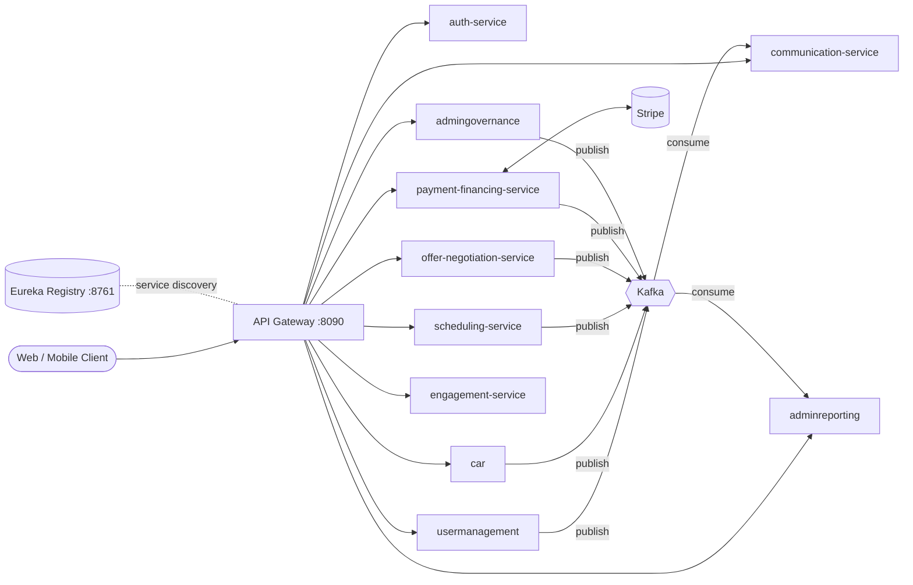

# CarVenture — Used-Car Marketplace Backend

An event-driven **microservices backend** for a used-car marketplace where sellers list cars, buyers search, negotiate, book test drives and pay (in full or via financing), and admins verify listings and track platform metrics.

Built with **Java 21, Spring Boot, Spring Cloud, PostgreSQL, Kafka and Stripe**. Twelve independently deployable services sit behind a single API Gateway, discover each other through Eureka, and talk asynchronously over Kafka.

---

## Table of Contents

- [Architecture](#architecture)
- [Services](#services)
- [Tech Stack](#tech-stack)
- [Engineering Highlights](#engineering-highlights)
- [Event Flow (Kafka)](#event-flow-kafka)
- [API Overview](#api-overview)
- [Getting Started](#getting-started)
- [Testing](#testing)
- [Known Limitations & Roadmap](#known-limitations--roadmap)

---

## Architecture



Each service owns its own PostgreSQL database (database-per-service). Services never share tables; they communicate through REST (Feign + circuit breakers) for queries and Kafka for events.

---

## Services

| Service | Port | Database | Responsibility |
|---|---|---|---|
| `eureka-server-app` | 8761 | — | Service registry / discovery |
| `api-gateway` | 8090 | — | Single entry point, load-balanced routing, CORS, SSE-safe timeouts |
| `auth-service` | 8080 | `carventure_auth_prod` | Registration, login, JWT access + refresh tokens, role management |
| `usermanagement` | 8086 | `carventure_users_prod` | Customer / seller / dealer / admin profiles |
| `car` | 8081 | `carventure_cars_prod` | Listings, search, price suggestion, image & document uploads |
| `scheduling-service` | 8083 | `carventure_scheduling_prod` | Seller availability and test-drive booking lifecycle |
| `offer-negotiation-service` | 8091 | `carventure_offer_prod` | Offers, counter-offers, time-boxed car reservations |
| `payment-financing-service` | 8082 | `carventure_payments_prod` | Orders, Stripe payments, financing plans, refunds |
| `engagement-service` | 8093 | `carventure_engagement_prod` | Wishlists, seller reviews and rating summaries |
| `communication-service` | 8092 | `carventure_communication_prod` | Notifications + real-time delivery over Server-Sent Events |
| `admingovernance` | 8084 | `carventure_admingovernance_prod` | Listing verification and dispute resolution |
| `admin` (`adminreporting`) | 8089 | `carventure_admin_prod` | Kafka-fed platform metrics and reports |

---

## Tech Stack

- **Language / Framework:** Java 21, Spring Boot, Spring Web, Spring Data JPA, Spring Security, Spring AOP
- **Microservices:** Spring Cloud Gateway, Netflix Eureka, OpenFeign, Resilience4j (circuit breaker + retry)
- **Messaging:** Apache Kafka (Spring Kafka)
- **Data:** PostgreSQL, Flyway migrations (payments, scheduling)
- **Security:** JWT (JJWT), role-based access control, service-to-service API key
- **Payments:** Stripe Java SDK (PaymentIntents, webhooks, refunds)
- **API Docs:** springdoc-openapi / Swagger UI on every service
- **Testing:** JUnit 5, Mockito, Spring Security Test, H2, Testcontainers (real PostgreSQL)
- **Build / Packaging:** Maven (with wrapper), Docker + Docker Compose (payments, scheduling)

---

## Engineering Highlights

### Double-booking is impossible — enforced in the database
Test-drive slots are protected in two layers: an application pre-check for a clean `409`, and a **PostgreSQL `EXCLUDE USING gist` constraint** on `(car_id, tsrange(start, end))` that is the real source of truth, so the guarantee holds across any number of service instances with no in-JVM locking. Status transitions use `SELECT … FOR UPDATE`, rescheduling is a single atomic `UPDATE`, and events go through a **transactional outbox** so a slow Kafka broker can never fail a booking. An integration test fires **10 concurrent overlapping inserts** at a real Postgres (Testcontainers) and asserts exactly one wins.

### A car can only be sold once — even when money has already moved
The same pattern guards purchases: an application check plus a **partial unique index** on `orders(car_id)` for paid/financing statuses. If two buyers race and the database rejects the loser *after* Stripe captured payment, the service **automatically refunds** that payment and marks the order `REFUNDED`. Stripe calls use **idempotency keys**, webhooks are **signature-verified** and de-duplicated via a `processed_webhook_events` table, and stale unpaid orders are expired by a scheduled sweeper.

### Role model with defense in depth
Roles are `CUSTOMER`, `SELLER`, `ADMIN`. A user may be both customer and seller, but **`ADMIN` is mutually exclusive** with both, enforced in the service layer on every grant. Self-registration can only ever create a `CUSTOMER` (there is no role field on the request payload at all). Authorization is **DB-backed**, so role changes take effect on the next request rather than waiting for token expiry. Admin routes are guarded by both URL-level rules and method-level `@PreAuthorize`. The first admin is created by an env-var-gated bootstrap runner rather than a public endpoint.

### Offers with reservations
Buyers can make offers, sellers can accept, reject or counter, and an accepted offer **reserves the car for a configurable window** (default 10 minutes) after which a scheduled sweeper releases it. Calls to the car and user services are wrapped in circuit breakers.

### Real-time notifications
Kafka events (offers, test drives, car sold) are turned into persisted notifications and **pushed to the browser over SSE**. The gateway has a dedicated no-timeout route for the stream so long-lived connections are not cut.

### Event-sourced reporting
The reporting service consumes user, listing, test-drive and order events to maintain report metrics and conversion tracking without ever querying other services' databases.

### Smart listings
Multi-filter car search (brand, model, price range, year, mileage, fuel type, transmission), a **price-suggestion** endpoint based on comparable listings, and secure upload of car photos and ownership documents (RC, insurance, PUC).

---

## Event Flow (Kafka)

| Topic | Producer | Consumer(s) |
|---|---|---|
| `user.registered` | usermanagement | adminreporting |
| `car.listed` | car | adminreporting |
| `listing.verified` | admingovernance | — |
| `offer-events` | offer-negotiation-service | communication-service |
| `test-drive-events` (outbox) | scheduling-service | communication-service |
| `testdrive.scheduled` / `testdrive.completed` | scheduling-service | adminreporting |
| `order.created` / `order.completed` | payment-financing-service | adminreporting |
| `order-events` | payment-financing-service | audit / history consumers |
| `car-sold-events` | payment-financing-service | communication-service |

---

## API Overview

All traffic goes through the gateway at `http://localhost:8090`. Every service also exposes Swagger UI at `/swagger-ui.html` on its own port.

| Prefix | Routed to | Highlights |
|---|---|---|
| `/api/auth/**` | auth-service | `register`, `login`, `refreshToken`, admin role grant/view |
| `/api/v1/user/**` | usermanagement | register/update/view customers, sellers, dealers, admins |
| `/api/v1/car/**` | car | `addCar`, `viewAllCars`, `searchCars`, `suggestPrice`, `uploadCarPictures`, `uploadCarDocuments`, `recommendations` |
| `/api/v1/availability/**`, `/api/v1/cars/**`, `/api/v1/test-drives/**` | scheduling-service | availability windows; request, confirm, reject, cancel, reschedule test drives |
| `/api/v1/offers/**` | offer-negotiation-service | create, accept, reject, counter, withdraw offers |
| `/api/v1/orders/**`, `/api/v1/payments/**` | payment-financing-service | create / cancel orders, Stripe webhook |
| `/api/v1/wishlist/**`, `/api/v1/reviews/**` | engagement-service | wishlist, seller reviews and summaries |
| `/api/v1/notifications/**`, `/api/v1/stream/**` | communication-service | notification inbox, unread count, SSE stream |
| `/api/v1/governance/**` | admingovernance | `verifyListing`, `resolveDispute` |
| `/api/v1/reporting/**` | adminreporting | `viewReports` |

Protected endpoints expect `Authorization: Bearer <access_token>`.

---

## Getting Started

### Prerequisites

- Java 21 and Maven (or use the bundled `./mvnw`)
- PostgreSQL 14+
- Apache Kafka (broker on `localhost:9092`)
- Docker (optional, for payments/scheduling compose files and Testcontainers)
- [Stripe CLI](https://stripe.com/docs/stripe-cli) (optional, to forward webhooks locally)

### 1. Create the databases

```sql
CREATE DATABASE carventure_auth_prod;
CREATE DATABASE carventure_users_prod;
CREATE DATABASE carventure_cars_prod;
CREATE DATABASE carventure_scheduling_prod;
CREATE DATABASE carventure_offer_prod;
CREATE DATABASE carventure_payments_prod;
CREATE DATABASE carventure_engagement_prod;
CREATE DATABASE carventure_communication_prod;
CREATE DATABASE carventure_admingovernance_prod;
CREATE DATABASE carventure_admin_prod;
```

### 2. Configure secrets (do not commit these)

Spring's relaxed binding lets you override any property from the environment:

```bash
export SPRING_DATASOURCE_USERNAME=<db-user>
export SPRING_DATASOURCE_PASSWORD=<db-password>

# Must be IDENTICAL across all services (auth-service signs, everyone else verifies)
export JWT_SECRET=$(openssl rand -base64 48)   # 48 bytes -> HS384 (matches scheduling-service default)

# Shared secret for internal service-to-service calls
export INTERNAL_API_KEY=$(openssl rand -base64 32)

# Payments
export STRIPE_SECRET_KEY=sk_test_...
export STRIPE_PUBLISHABLE_KEY=pk_test_...
export STRIPE_WEBHOOK_SECRET=whsec_...
```

> The JWT signing algorithm is chosen from the secret's byte length. If you change the secret length, update `jwt.mac-algorithm` in `scheduling-service` to match.

### 3. Start the services (in this order)

```bash
# 1. Service registry
cd eureka-server-app && ./mvnw spring-boot:run

# 2. Core services (each in its own terminal)
cd auth-service && ./mvnw spring-boot:run
cd usermanagement && ./mvnw spring-boot:run
cd car && ./mvnw spring-boot:run
cd scheduling-service && ./mvnw spring-boot:run
cd offer-negotiation-service && ./mvnw spring-boot:run
cd payment-financing-service && ./mvnw spring-boot:run
cd engagement-service && ./mvnw spring-boot:run
cd communication-service && ./mvnw spring-boot:run
cd admingovernance && ./mvnw spring-boot:run
cd admin && ./mvnw spring-boot:run

# 3. Gateway last
cd api-gateway && ./mvnw spring-boot:run
```

Check `http://localhost:8761` to confirm everything has registered.

### 4. Create the first admin

On the **first boot only**, start `auth-service` with:

```bash
export ADMIN_BOOTSTRAP_USERNAME=<admin-username>
export ADMIN_BOOTSTRAP_PASSWORD=<strong-password>
```

If no admin exists, one is created. Unset both variables afterwards and rotate the password.

### 5. Try it

```bash
# Register (always creates a CUSTOMER)
curl -X POST http://localhost:8090/api/auth/register \
  -H 'Content-Type: application/json' \
  -d '{"username":"alice","password":"S3cure!pass"}'

# Log in
curl -X POST http://localhost:8090/api/auth/login \
  -H 'Content-Type: application/json' \
  -d '{"username":"alice","password":"S3cure!pass"}'
```

### Stripe webhooks locally

```bash
stripe listen --forward-to localhost:8082/api/v1/payments/webhook
```

Copy the printed `whsec_...` into `STRIPE_WEBHOOK_SECRET`.

### Docker

`payment-financing-service` and `scheduling-service` ship with a `Dockerfile` and `docker-compose.yml`:

```bash
cd payment-financing-service && docker compose up --build
```

---

## Testing

```bash
mvn test          # run inside any service directory
```

| Service | What is covered |
|---|---|
| `auth-service` | Register / login / refresh, role-exclusivity rules, smuggled-role payload is ignored, real `SecurityConfig` rejects non-admins, JWT utilities, admin bootstrap, JPA repository |
| `scheduling-service` | Authorization and state-transition rules, availability fit, overlap handling, web-layer error mapping, **concurrency integration test on real PostgreSQL** |
| `payment-financing-service` | Order and down-payment logic, refund-the-loser path, idempotent webhooks, invalid-signature rejection, **sale-conflict integration test on real PostgreSQL** |

Integration tests use Testcontainers and require Docker.

---

## Known Limitations & Roadmap

- `recommendations` currently returns the latest active listings; a personalised engine based on browsing and purchase history is planned.
- The `location` search filter is accepted but not yet applied (no location column on `Car`).
- Financing is a simple interest-free equal-installment schedule; a real lending-partner integration would sit behind `OrderService`.
- The transactional outbox is implemented in `scheduling-service`; other producers publish directly and would benefit from the same pattern.
- `auth-service` can grant roles but has no role-revocation endpoint yet.
- Test coverage outside auth, scheduling and payments is limited to context-load tests.
- Centralised configuration (Spring Cloud Config) and a frontend client are not part of this repository.

---

## Author

**Sujal Pachori**